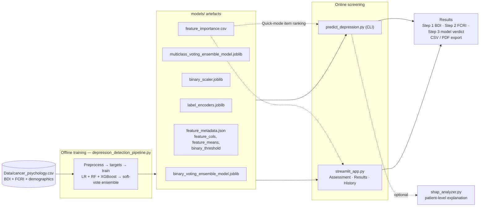
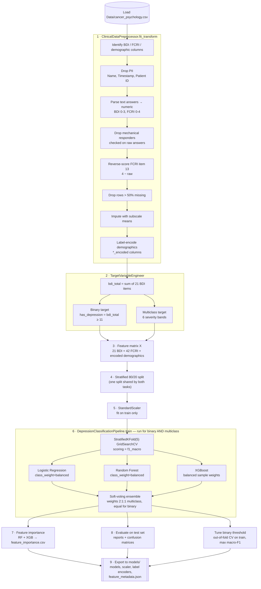
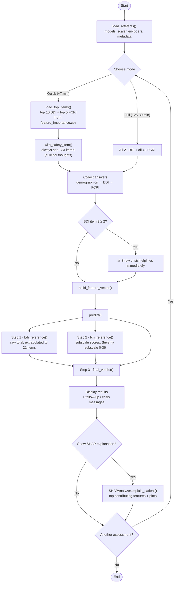
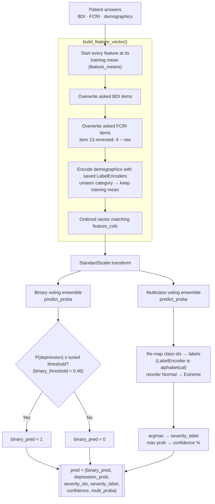
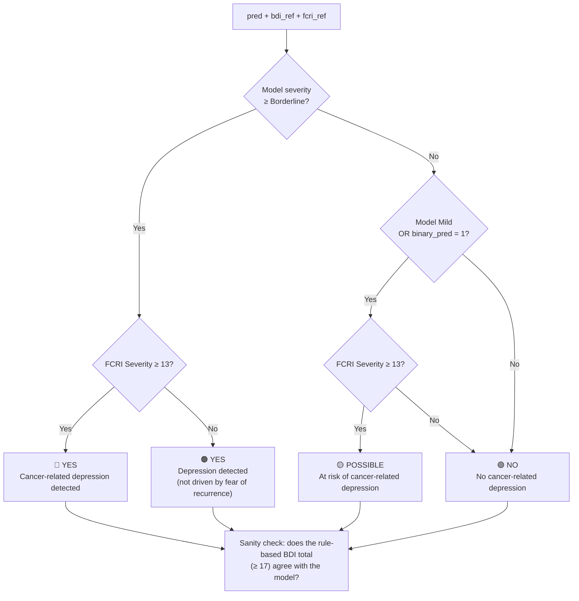
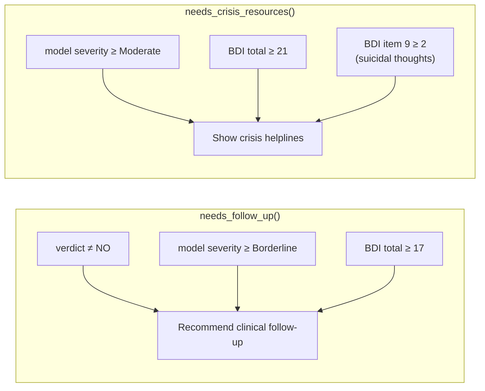

# Model Flow

How the depression-detection framework is trained, how it is used, and how a
single prediction is made. Diagrams are Mermaid and render on GitHub and in
VS Code's Markdown preview.

1. [System overview](#1-system-overview)
2. [Training pipeline](#2-training-pipeline-depression_detection_pipelinepy)
3. [Assessment workflow](#3-assessment-workflow-predict_depressionpy--streamlit-app)
4. [Model prediction](#4-model-prediction)
5. [Final verdict and safety rules](#5-final-verdict-and-safety-rules)

---

## 1. System overview

---

## 2. Training pipeline (`depression_detection_pipeline.py`)

**Severity bands (BDI total → label)**

| BDI total | Label |
|---|---|
| 0–10 | Normal |
| 11–16 | Mild mood disturbance |
| 17–20 | Borderline clinical depression |
| 21–30 | Moderate depression |
| 31–40 | Severe depression |
| 41–63 | Extreme depression |

> **Known scoring issue in the training data (found 2026-10-18).** `_parse_bdi()` matches keywords inside
> the answer text, so the score-0 statements of BDI item 6 ("I don't feel I am being punished") and item 7
> ("I don't feel disappointed in myself") are scored 3 and 1. This affects 717 answers and changes 185
> severity labels in `Data/cancer_psychology.csv`; the saved models in `models/` were trained on these labels.
> The app itself is not affected at prediction time, because the Assessment page scores answers by option
> position. The thesis analysis (`thesis_analysis/`) applies the corrected scoring; the deployed models have
> not been retrained.

---

## 3. Assessment workflow (`predict_depression.py` / Streamlit app)

---

## 4. Model prediction

What happens inside `build_feature_vector()` and `predict()` for one patient.

In Quick mode, unasked items keep their training-mean value, so the model
always receives a full-length vector without treating missing answers as
"no symptom".

---

## 5. Final verdict and safety rules

`final_verdict()` combines the model's output with the FCRI Severity subscale
(cut-off ≥ 13, Simard & Savard).

Safety messages are shown when **either** the model or the BDI total triggers
them:

