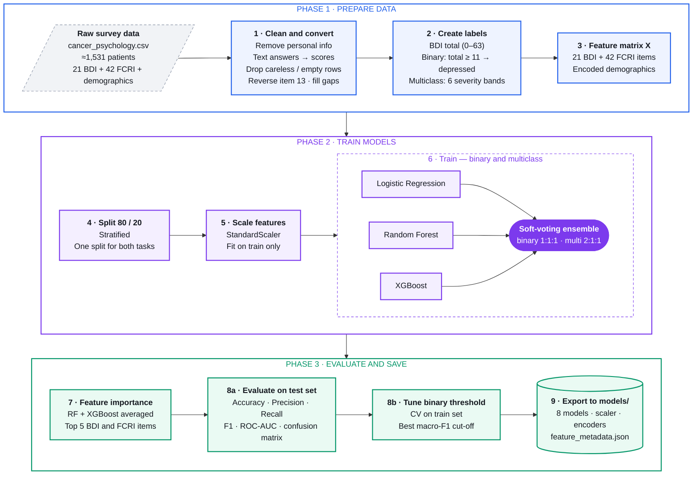

# Training Pipeline

`depression_detection_pipeline.py`: from raw survey answers to saved, ready-to-use models.

| Step | What happens | Key detail |
| --- | --- | --- |
| 1 | Clean and convert | Text answers become BDI 0–3 / FCRI 0–4. Personal info removed. Bad rows dropped. The negated answers of BDI items 6 and 7 were mis-scored until 2026-10-26; the saved models were retrained after the fix (see MODEL_FLOW.md). |
| 2 | Create labels | Binary: BDI total ≥ 11. Multiclass: Normal → Extreme (6 bands). |
| 3 | Feature matrix | BDI + FCRI items + encoded demographics. |
| 4 | Split | 80 / 20 stratified, shared by both tasks. |
| 5 | Scale | StandardScaler fitted on training data only. |
| 6 | Train | LR, RF, XGBoost tuned with GridSearchCV (5-fold, macro-F1, balanced weights), then combined in a soft-voting ensemble. |
| 7 | Feature importance | Top items, so a shorter mobile screening is possible. |
| 8 | Evaluate + threshold | Scored on the unseen test set. Binary cut-off tuned on training CV. |
| 9 | Export | Saved to `models/`, then loaded by `predict_depression.py` and the Streamlit app. |
